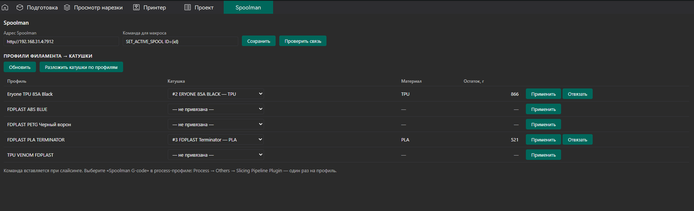
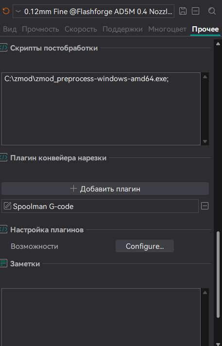
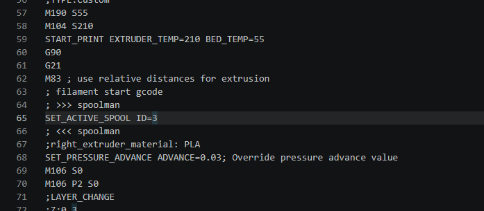

# MAD-Spoolman

OrcaSlicer plugin that links filament presets to [Spoolman](https://github.com/Donkie/Spoolman)
spools and writes the active spool command into the G-code before a filament is printed.

## What it does

- Adds a **Spoolman** tab where every filament preset is listed with a spool picker.
  Picking a spool stores the binding; the presets themselves are never modified and no
  duplicate presets are created.
- The **Match spools to presets** button goes through all spools in Spoolman and binds the ones
  that have no binding yet. It first looks for an existing preset that matches the spool
  (vendor, filament name, material) and only creates a new preset when nothing matches.
- A second capability, **Spoolman G-code**, inserts the configured command with the bound spool
  ID into the exported G-code:

  ```
  ; >>> spoolman
  SET_ACTIVE_SPOOL ID=3
  ; <<< spoolman
  ```

  The block goes right after the `; filament start gcode` marker, so the printer receives it
  before the first layer of that filament. On multi-material prints every filament that becomes
  active gets its own command at the matching tool change.

## Screenshots

**Spoolman tab** — every filament preset with a spool picker, material and remaining weight:



**Enabling the G-code step** — process settings → Others → Slicing Pipeline Plugin:



**Result in the exported G-code** — the command sits between the filament start marker and the
pressure advance override:



## Requirements

- OrcaSlicer 2.5.0 or newer (the Python plugin system).
- A reachable Spoolman instance. The address is set in the plugin tab, default
  `http://localhost:7912`.
- A firmware macro that accepts the spool ID. The default command is
  `SET_ACTIVE_SPOOL ID={id}`; any macro can be used as long as it contains `{id}`,
  for example `SET_ACTIVE_SPOOL ID={id}` for Klipper with the Spoolman integration.

## Installation

1. Download `mad_spoolman_any.py` from the latest release (or use Orca Cloud once the plugin is
   published there).
2. In OrcaSlicer open **File → Plugins**, click **Install local plugin** and choose the file.
3. Activate the plugin and open the **Spoolman** tab.
4. Set the Spoolman address and press **Check connection**.
5. Allow network access when OrcaSlicer asks — the permission is remembered per plugin.

## Enabling the G-code step

The insertion runs at the end of slicing, which has to be turned on in the process preset:

1. Switch to **Advanced** mode.
2. Open the process settings → **Others** → **Slicing Pipeline Plugin**.
3. Add **Spoolman G-code**.
4. Repeat for every process preset you slice with.

Without this step the plugin still binds spools but does not touch the G-code.

## How bindings are stored

Bindings live in the plugin's data folder (`orca_plugins/plugin_data/mad_spoolman/bindings.json`
on Windows) as a map from the preset name to the spool ID. Switching a spool takes effect on the
next slice; nothing has to be restarted.

Presets created by the plugin are written into a local preset bundle
(`user/<id>/_local/mad-spoolman/`). They inherit from a Generic profile of the same material, or
from your own preset of that filament when one matches, and are marked in the tab.

## Permissions

The plugin needs network access to your Spoolman instance. It reads and writes files only inside
the OrcaSlicer data folder. No data leaves your machine except the requests to the Spoolman
address you configure.

## Troubleshooting

- **Nothing appears in the G-code.** Check that `Spoolman G-code` is selected in the process
  preset (see above) and that the filament preset used for the slice has a bound spool.
- **Multi-material prints.** Each filament is matched to the tool that prints it (`T0`, `T1`, ...);
  a filament without a bound spool gets no command. Custom AMS-style change G-code is not parsed,
  because the plugin targets printers driven by plain tool changes.
- **`PermissionError` in the log.** Network access was not granted; reopen the tab and allow it.
- **Spoolman is not reachable.** The check button reports the error. Make sure the address
  includes the port and that Spoolman allows CORS-free API access from localhost (it does by
  default).

The plugin writes diagnostics to OrcaSlicer's Python log:
`<OrcaSlicer data folder>/log/python_*.log`.

## Development

The plugin is a single file, `mad_spoolman_any.py`. The `_any` suffix is required by the
Orca Cloud publisher: uploaded plugin files must name their target platform, and `any` marks a
platform-independent plugin.

### Releases

Releases are published automatically. The workflow in
`.github/workflows/publish-orcacloud.yml` uploads the plugin file to Orca Cloud on every
published GitHub release, using GitHub OIDC — there are no tokens to store.

1. Bump `version` in the plugin metadata and in `PLUGIN_VERSION`, update `CHANGELOG.md`.
2. Create a release with a semantic-version tag, for example `v1.0.1`. The tag must be higher
   than the version currently published on Orca Cloud.
3. Publish the release. The release notes become the changelog on Orca Cloud.

## License

MIT — see [LICENSE](LICENSE).
